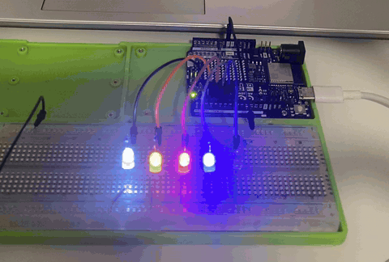
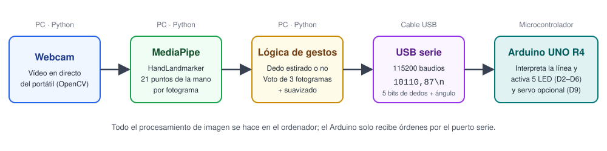
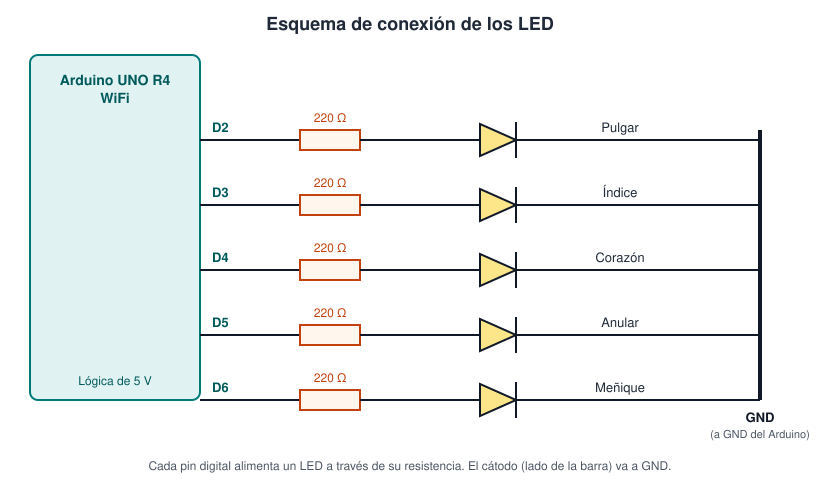
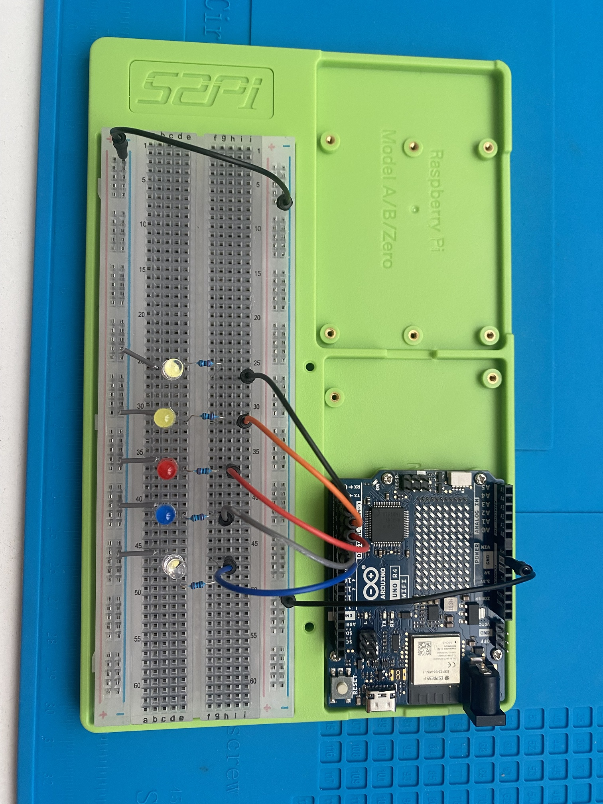
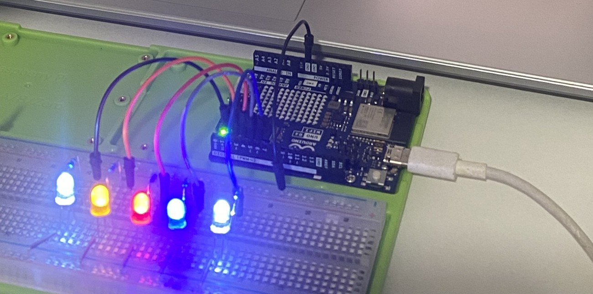

# Mano → LEDs

### Control de LEDs por visión artificial con Arduino UNO R4 WiFi


La webcam del portátil detecta la mano en tiempo real y **cada dedo que se estira enciende un LED** en una protoboard conectada a un Arduino UNO R4 WiFi. Un script de Python hace la visión artificial y manda el resultado por USB; el Arduino solo interpreta las órdenes y controla la electrónica.

<p align="center">
  
</p>

## Índice

1. [Qué hace](#qué-hace)
2. [Arquitectura](#arquitectura)
3. [Hardware](#hardware)
4. [Esquema de conexión](#esquema-de-conexión)
5. [Protocolo serie](#protocolo-serie)
6. [Detección de dedos](#detección-de-dedos)
7. [Instalación y uso](#instalación-y-uso)
8. [Ajustes](#ajustes)
9. [Pruebas realizadas](#pruebas-realizadas)
10. [Problemas encontrados y soluciones](#problemas-encontrados-y-soluciones)
11. [Detalle a tener en cuenta: corriente por pin](#detalle-a-tener-en-cuenta-corriente-por-pin)
12. [Posibles mejoras](#posibles-mejoras)
13. [Estructura del repositorio](#estructura-del-repositorio)

## Qué hace

- Detecta una mano con la webcam y localiza **21 puntos clave** (muñeca, nudillos, articulaciones y puntas de los dedos).
- Decide qué dedos están estirados y cuáles doblados, sin importar la distancia a la cámara ni la orientación de la mano.
- Envía ese estado por USB a la placa, que enciende o apaga **un LED por dedo**.
- Mide además la distancia entre pulgar e índice (gesto de pellizco) para mover un **servo**. Esta parte está implementada en el código, pero no está conectada en la demo.

## Arquitectura



| Etapa | Dónde se ejecuta | Qué hace |
|---|---|---|
| Captura | Ordenador (OpenCV) | Lee el vídeo de la webcam fotograma a fotograma |
| Detección | Ordenador (MediaPipe) | Obtiene los 21 puntos de la mano con el modelo *Hand Landmarker* |
| Lógica de gestos | Ordenador (Python) | Convierte los puntos en "dedo estirado / doblado" y filtra el ruido |
| Comunicación | Cable USB | Una línea de texto cada vez que cambia el estado, a 115200 baudios |
| Actuación | Arduino UNO R4 WiFi | Lee la línea, enciende los LED y mueve el servo si lo hay |

El reparto es deliberado: la parte pesada (imagen) se hace en el ordenador y el microcontrolador queda libre para lo que se le da bien, controlar pines.

## Hardware

| Cantidad | Componente | Notas |
|---|---|---|
| 1 | Arduino UNO R4 WiFi | Lógica de 5 V |
| 1 | Cable USB-C **con datos** | Los cables solo de carga no sirven (ver [problemas](#problemas-encontrados-y-soluciones)) |
| 1 | Protoboard | |
| 5 | LED | Uno por dedo |
| 5 | Resistencias de 220 Ω | Ver [corriente por pin](#detalle-a-tener-en-cuenta-corriente-por-pin) |
| — | Cables jumper macho-macho | |
| 1 | Portátil con webcam | |
| 1 | *Opcional:* servo 9 g | Para el control por pellizco |

## Esquema de conexión



| Dedo | Pin Arduino |
|---|---|
| Pulgar | D2 |
| Índice | D3 |
| Corazón | D4 |
| Anular | D5 |
| Meñique | D6 |
| *Servo (señal, opcional)* | D9 |

Cada LED se conecta así: **pin digital → resistencia → LED (pata larga, el ánodo, hacia la resistencia) → GND**. El servo opcional lleva la señal a D9, el cable rojo a 5 V y el marrón o negro a GND.

<p align="center">
  
  
</p>

## Protocolo serie

Python envía una línea de texto cada vez que cambia el estado de los dedos o del servo (no en cada fotograma), a **115200 baudios**:

```
10110,87\n
```

| Posición | Contenido | Valores |
|---|---|---|
| Caracteres 0–4 | Estado de cada dedo, en orden pulgar → meñique | `1` = estirado, `0` = doblado |
| Carácter 5 | Separador | `,` |
| Desde el carácter 6 | Ángulo del servo | Entero de 0 a 180 |

En el ejemplo, `10110,87` significa: pulgar, corazón y anular estirados; índice y meñique doblados; servo a 87°. Al cerrar el programa, Python envía `00000,90` para dejar los LED apagados y el servo en reposo.

Usar texto en lugar de bytes binarios hace que se pueda depurar a simple vista desde el Monitor Serie del IDE.

## Detección de dedos

Todas las distancias se normalizan con el **tamaño de la mano** (distancia entre la muñeca y la base del dedo corazón, puntos 0 y 9 de MediaPipe). Así el resultado no depende de lo cerca que esté la mano de la cámara ni de cómo esté girada.

| Elemento | Criterio |
|---|---|
| Índice, corazón, anular, meñique | Estirado si la punta está **más lejos de la muñeca** que la articulación intermedia (PIP). Al doblar el dedo, la punta vuelve hacia la palma |
| Pulgar | Estirado si la distancia punta (4) – base del índice (5), dividida entre el tamaño de la mano, supera `UMBRAL_PULGAR` (0,55) |
| Pellizco (servo) | Distancia punta del pulgar (4) – punta del índice (8) entre el tamaño de la mano; se traduce linealmente de 0,15 → 0° a 1,00 → 180° |
| Filtrado de LED | Votación por mayoría entre los últimos 3 fotogramas, para evitar parpadeos |
| Filtrado del servo | Suavizado exponencial (factor 0,3) |

## Instalación y uso

### 1. Placa

1. Instala el [Arduino IDE](https://www.arduino.cc/en/software) y, desde el Gestor de placas, el paquete **Arduino UNO R4 Boards**.
2. Abre `mano_leds.ino`, selecciona *Arduino UNO R4 WiFi* y su puerto, y súbelo.
3. Al arrancar, los LED se encienden de uno en uno: es una comprobación del cableado.

### 2. Ordenador

Requiere Python 3.9 o superior.

```bash
git clone https://github.com/antonionzdev/mano-leds-arduino.git
cd mano-leds-arduino
pip install -r requirements.txt
```

### 3. Ejecutar

Cierra el Monitor Serie del IDE (solo un programa puede usar el puerto a la vez) y ejecuta:

```bash
python mano_leds.py --puerto COM4
```

Cambia `COM4` por el puerto de tu placa (en Linux, algo como `/dev/ttyACM0`). Opciones disponibles:

| Opción | Descripción |
|---|---|
| `--puerto` | Puerto serie de la placa |
| `--camara` | Índice de la cámara (por defecto 0; prueba `1` si no se abre) |
| `--sin-placa` | Solo cámara y detección, sin Arduino; sirve para probar la parte de visión |

La primera vez descarga el modelo `hand_landmarker.task` de Google (unos pocos MB). Se sale pulsando **q** o **Esc** con la ventana de la cámara seleccionada.

## Ajustes

Al principio de `mano_leds.py` hay constantes que se pueden cambiar si algún gesto no responde bien. La ventana de la cámara muestra los valores en vivo para ayudar a calibrarlas.

| Constante | Qué controla |
|---|---|
| `UMBRAL_PULGAR` | A partir de qué distancia el pulgar cuenta como estirado |
| `PELLIZCO_CERRADO` | Valor del pellizco con los dedos juntos (servo a 0°) |
| `PELLIZCO_ABIERTO` | Valor del pellizco con los dedos separados (servo a 180°) |
| `SUAVIZADO` | Cuánto se suaviza el movimiento del servo |

## Pruebas realizadas

| Elemento | Detalle |
|---|---|
| Sistema operativo | Windows |
| Python | 3.14 |
| MediaPipe | 1.2.2 |
| Placa | Arduino UNO R4 WiFi (puerto COM4) |
| Cámara | Webcam integrada del portátil |
| Resultado | Los 5 LED responden a cada dedo de forma independiente |

El servo está implementado en el código pero **no se ha probado en hardware**.

## Problemas encontrados y soluciones

| Problema | Causa | Solución |
|---|---|---|
| La placa no aparece como puerto en el IDE | El cable USB solo cargaba, no transmitía datos | Usar un cable con datos (de cuatro cables probados, solo uno funcionaba) |
| Error al abrir el puerto desde Python | El Monitor Serie del IDE tenía el puerto ocupado | Cerrar el Monitor Serie antes de ejecutar el script |
| Los ejemplos de MediaPipe no funcionan (`mp.solutions`) | Esa API antigua ya no existe en las versiones actuales | Usar la API nueva `HandLandmarker`, que necesita el archivo de modelo `.task` (el script lo descarga solo) |
| LED con comportamiento extraño antes de subir el sketch | La placa seguía ejecutando un programa anterior | Subir `mano_leds.ino`; si el IDE no detecta la placa, pulsar dos veces RESET para entrar en el *bootloader* |

## Detalle a tener en cuenta: corriente por pin

Los pines digitales del UNO R4 WiFi admiten como máximo **8 mA** cada uno. Con una única resistencia de 220 Ω, cada LED consume algo más que eso. Con tensiones directas típicas (≈2 V rojo y amarillo, ≈3 V azul y blanco):

`I = (5 V − Vf) / R`

| LED | Cálculo con 220 Ω | Corriente |
|---|---|---|
| Rojo (≈2,0 V) | (5 − 2,0) / 220 | ≈ 13,6 mA |
| Amarillo (≈2,1 V) | (5 − 2,1) / 220 | ≈ 13,2 mA |
| Azul / blanco (≈3,0 V) | (5 − 3,0) / 220 | ≈ 9,1 mA |

Este montaje usa **una resistencia de 220 Ω por LED**, así que funciona ligeramente por encima de la especificación. Para dejarlo dentro de ella, lo recomendable es poner **dos resistencias de 220 Ω en serie por LED** (440 Ω), con lo que la corriente baja a unos 6,8 / 6,6 / 4,5 mA. Otra opción es alimentar los LED mediante transistores.

Los valores de Vf son típicos de hoja de datos, no medidos en estos LED. En la demo todo funcionó correctamente, pero un diseño pensado para durar debería respetar el límite.

## Posibles mejoras

- Montar el servo y controlarlo con el pellizco (el código ya lo soporta).
- Reconocer gestos concretos (puño, paz, "ok") en lugar de contar dedos.
- Pasar de LED a otros actuadores: un relé, un brazo robótico, etc.
- Manejar con limpieza la interrupción con Ctrl+C.
- Añadir una segunda mano y mapear sus dedos a otras salidas.

## Estructura del repositorio

```
mano-leds-arduino/
├── mano_leds.py        Script de Python: cámara, detección de la mano y envío por serie
├── mano_leds.ino       Sketch de Arduino: recibe el mensaje y controla LED y servo
├── requirements.txt    Dependencias de Python
├── LICENSE             Licencia MIT
└── media/              Demo, fotos del montaje y esquemas
```

## Autor

**Antonio Navarro** · Técnico en electrónica, estudiante del Grado Superior en Mantenimiento Electrónico · Málaga, España
[github.com/antonionzdev](https://github.com/antonionzdev)

## Licencia

Distribuido bajo licencia MIT. Consulta el archivo [LICENSE](LICENSE).
